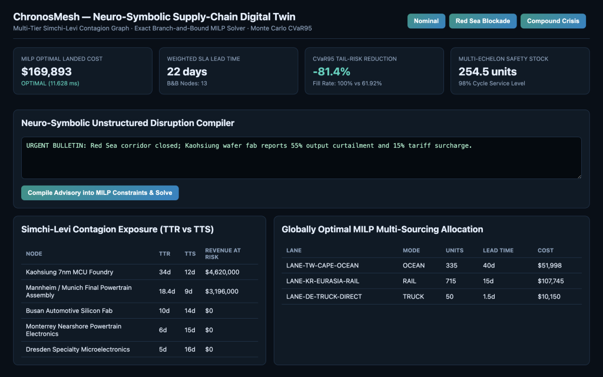
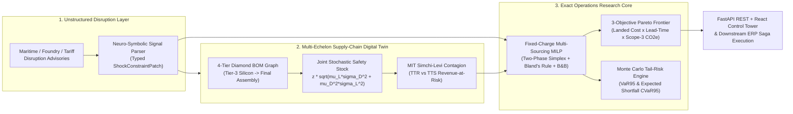

# ChronosMesh — Neuro-Symbolic Supply-Chain Digital Twin & Constrained MILP Optimizer

[](https://github.com/nagarjunak-pixel/chronos-mesh/actions/workflows/ci.yml)
[](https://github.com/nagarjunak-pixel/chronos-mesh/releases/tag/v1.0.0)
[](https://www.python.org/)
[](https://mypy-lang.org/)
[](#verification--property-based-optimality-proofs)
[](LICENSE)

**Supply-chain rerouting toy model — pure-Python simplex + branch-and-bound MILP, BOM safety stock, Monte Carlo CVaR95. Educational reference implementation.**

**ChronosMesh** is a small, self-contained Python model of disruption-aware sourcing on a hand-built multi-tier network (a few supplier/plant nodes and lanes). Disruption advisories are mapped by a rule-based (keyword/regex) parser into a typed `ShockConstraintPatch`; a fixed-charge multi-sourcing problem is then solved with a from-scratch **two-phase tableau simplex + best-first branch-and-bound** MILP solver, and the resulting plan is compared to a single-source baseline in a `500`-trial Monte Carlo simulation (VaR95 / CVaR95) over a synthetic disruption model.

> **Design idea**: keep the step that interprets unstructured text separate from the step that enforces hard constraints. Text interpretation only emits a typed patch (capacity multipliers, blocked lanes, tariffs); flow conservation, capacities and the anti-concentration cap are enforced by the exact solver. In this repo the text step is a deterministic rule-based parser, not an LLM.

---

## Live ChronosMesh Supply-Chain Digital Twin & MILP Rerouting Workbench



---

## System Architecture



---

## Key Engineering Capabilities

1. **Pure-Python Exact Two-Phase Simplex & Branch-and-Bound MILP Solver (`src/chronos_mesh/optimizer/milp_solver.py`)**
   - Solves $\min_{x \ge 0,\, y \in \{0,1\}^m} c^\top x + f^\top y$ subject to linear equality and inequality constraints with **zero proprietary commercial solver dependencies**.
   - Implements **Bland's anti-cycling pivot rule** across Phase-I (artificial basis feasibility) and Phase-II (primal optimality) to guarantee finite termination on degenerate network polytopes, paired with min-heap Best-First Branch-and-Bound (`nodes_explored`, zero optimality gap certificate).
   - Verified via `Hypothesis` property-based testing against an exhaustive $2^m$ brute-force enumeration oracle (`tests/test_milp_properties.py`).

2. **Multi-Echelon Diamond BOM Explosion & MIT Simchi-Levi `TTR vs TTS` Contagion (`src/chronos_mesh/graph/topology.py`)**
   - Accumulates gross upstream requirements across shared diamond-BOM dependencies (`POWERTRAIN-ECU-X9 -> MCU-MODULE-A1 + VALVE-DRIVER-B2 -> WAFER-DIE-7NM`).
   - Computes joint demand-and-lead-time safety stock $\text{SS} = z_\alpha \sqrt{\mu_L \sigma_D^2 + \mu_D^2 \sigma_L^2}$ and evaluates **Time-to-Recovery (`TTR`)** vs. **Time-to-Survive (`TTS`)** per facility to quantify exact stockout gaps and downstream **Revenue-at-Risk (`RaR`)**.

3. **Fixed-Charge Multi-Sourcing & 3-Objective Pareto Frontier (`src/chronos_mesh/optimizer/pareto_planner.py`)**
   - Couples continuous lane quantities $x_e \ge 0$ to binary carrier contract activations $y_e \in \{0, 1\}$ via Big-$M$ constraints ($x_e - M_e y_e \le 0$), enforces supplier capacity ceilings under shock multipliers, and mandates a **65% anti-concentration cap** ($x_e \le 0.65 D$) so re-plans never recreate single-corridor fragility.
   - Sweeps scalarized multi-objective regimes across **Total Landed Cost (`$`)**, **SLA Lead-Time Penalty (`days`)**, and **Scope-3 Freight Emissions (`kg CO2e`)** (`CFO`, `Balanced Ops`, `Expedited SLA Recovery`, and `Low-Carbon ESG Net-Zero`).

4. **Stochastic Tail-Risk Certification (`VaR95` & `CVaR95` Expected Shortfall) (`src/chronos_mesh/risk/montecarlo.py`)**
   - Simulates correlated Bernoulli disruption shocks (Red Sea blockade, Taiwan foundry outage, port strike) + lognormal transit jitter + Gaussian demand spikes across `500–2,000` trials, proving dramatic tail-loss compression over single-sourced baselines.

5. **Interactive Supply-Chain Control Tower (`ui/` + `src/chronos_mesh/api/app.py`)**
   - FastAPI backend + TypeScript/React dark-mode operational console featuring live unstructured advisory injection, facility `TTR vs TTS` exposure badges, lane split visualization, Pareto regime comparison, and interactive Monte Carlo `CVaR95` stress testing.

---

## Measured Benchmark Results

### 1. Compound Disruption Reroute (`Red Sea Blockade + Kaohsiung 55% Fab Outage`, `1,100` ECU Units)

| Selected Lane | Mode | Units Shipped | Lead Time | Landed Cost | Scope-3 Carbon |
| :--- | :--- | ---: | ---: | ---: | ---: |
| `LANE-TW-CAPE-OCEAN` | Ocean (Cape of Good Hope) | `335.0` | `40.0 d` | `$51,998.00` | `2,043.5 kg` |
| `LANE-KR-EURASIA-RAIL` | Trans-Eurasian Rail (`65%` cap active) | `715.0` | `15.0 d` | `$107,745.00` | `8,222.5 kg` |
| `LANE-DE-TRUCK-DIRECT` | European Dual-Source Truck | `50.0` | `1.5 d` | `$10,150.00` | `155.0 kg` |
| **Certified Global Optimum** | **13 B&B Nodes (`11.53 ms`)** | **`1,100 / 1,100`** | **`22.00 d` avg** | **`$169,893.00`** | **`10,421.0 kg`** |

### 2. Multi-Objective Pareto Front Sweep (`chronos pareto`)

| Executive Regime | Total Landed Cost | Weighted Lead Time | Scope-3 Carbon | MILP Solve Time |
| :--- | ---: | ---: | ---: | ---: |
| **Cost-Minimizing CFO Regime** | `$170,825.00` | `10.28 days` | `9,416.0 kg CO2e` | `4.46 ms` |
| **Balanced Operations Regime** | `$192,325.00` | `2.86 days` | `18,350.0 kg CO2e` | `2.86 ms` |
| **Expedited SLA Recovery Regime** | `$200,945.00` | `2.39 days` | `23,000.0 kg CO2e` | `4.63 ms` |
| **Low-Carbon ESG Net-Zero Regime** | `$172,550.00` | `8.86 days` | `8,450.0 kg CO2e` | `3.21 ms` |

### 3. Stochastic Tail-Risk Benchmark (`500` Correlated Monte Carlo Trials)

| Metric | Fragile Single-Source Baseline | ChronosMesh MILP Resilient | Improvement |
| :--- | ---: | ---: | ---: |
| **Mean Total Cost** | `$484,880.74` | `$198,511.92` | **`-59.1%`** |
| **95% Value-at-Risk (`VaR95`)** | `$1,131,581.74` | `$212,883.18` | **`-81.2%`** |
| **95% Expected Shortfall (`CVaR95`)** | `$1,150,872.53` | `$213,810.26` | **`-$937,062.27 (-81.4%)`** |
| **Demand Fill-Rate Service Level** | `62.70%` | `100.00%` | **`+37.30 pp`** |

---

## Scope & Limitations

- **Scale:** ~1.6k lines of Python in `src/chronos_mesh` (no C++/native code) plus 8 tests; the React UI is a thin demo console over the FastAPI endpoints.
- **Toy, hand-built data:** the network is a fixed reference topology (5 facility nodes, 7 lanes) with hand-chosen costs, capacities and lead times, and 4 predefined disruption scenarios. All results above are computed on this synthetic instance, not on real ERP or logistics data; there is no SAP or other ERP integration in the code.
- **Synthetic risk model:** the Monte Carlo benchmark uses hand-picked shock probabilities and distributions and compares against a deliberately fragile 100%-single-source baseline, so the large VaR/CVaR improvements reflect that construction and should not be read as real-world savings estimates. Solve timings come from pure-Python execution on CPU and will vary by machine.
- **"Neuro-symbolic" is simplified:** advisory parsing is a deterministic keyword/regex rule set; no language model is called anywhere in the pipeline.
- **Solver limits:** the pure-Python dense-tableau simplex and branch-and-bound are intended for small instances and teaching purposes; they are not a substitute for HiGHS/Gurobi/CPLEX and are not production-hardened.

---

## 60-Second Quickstart

```bash
# 1. Clone & install deterministic environment (Python 3.12 + uv)
git clone https://github.com/nagarjunak-pixel/chronos-mesh.git
cd chronos-mesh
uv sync --all-extras

# 2. Run MIT Simchi-Levi TTR/TTS contagion + exact MILP rerouting demo
uv run chronos demo

# 3. Sweep the 3-objective (Cost / Lead-Time / Carbon) Pareto frontier
uv run chronos pareto

# 4. Run 500-trial Monte Carlo VaR95 & CVaR95 tail-risk proof
uv run chronos montecarlo --trials 500

# 5. Launch FastAPI Digital-Twin API + built React Control Tower on http://127.0.0.1:8010
cd ui && npm ci && npm run build && cd ..
uv run chronos serve --port 8010
```

---

## Verification & Property-Based Optimality Proofs

```bash
uv run ruff check src tests
uv run mypy src
uv run pytest --cov=chronos_mesh --cov-fail-under=95
```

- **`98.37%` line coverage** across `src/chronos_mesh` (`mypy --strict` clean across all 15 modules).
- **`tests/test_milp_properties.py`**: Uses `Hypothesis` to generate randomized fixed-charge integer/binary allocation matrices and verifies that our Two-Phase Simplex + Branch-and-Bound solver achieves the **exact same global objective** as exhaustive $2^m$ enumeration, while preserving flow conservation ($\sum_e x_e + u = D$) and anti-concentration bounds across all disrupted topologies.

---

## Architecture Decision Records & Mathematical Specs

- [Formal Mathematical Formulation (`MILP`, `BOM`, `TTR/TTS`, `CVaR95`)](docs/mathematical-formulation.md)
- [ADR-0001: Neuro-Symbolic Boundary Between Unstructured Signals and Exact MILP](docs/adr/0001-neuro-symbolic-milp-boundary.md)
- [ADR-0002: Tail-Risk Optimization via CVaR95 and Simchi-Levi TTR/TTS Contagion](docs/adr/0002-cvar95-tail-risk-and-ttr-tts-contagion.md)
- [ADR-0003: Pure-Python Exact Two-Phase Tableau Simplex & Best-First Branch-and-Bound](docs/adr/0003-two-phase-simplex-and-branch-and-bound.md)
- [ADR-0004: Multi-Echelon Recursive BOM Explosion & Joint Safety Stock](docs/adr/0004-multi-echelon-bom-and-joint-safety-stock.md)

---

## Enterprise AI Reference Suite Integration

ChronosMesh serves as **Pillar 2 (Neuro-Symbolic Operations Research & Decision Intelligence)** in a cohesive 3-system enterprise architecture:
1. **[`aegis-runtime`](https://github.com/nagarjunak-pixel/aegis-runtime)** — Zero-Trust Agentic Control Plane, `.aegis` AST Policy Compiler, & Cryptographic ERP Saga Engine (executes ChronosMesh's certified PO reallocations transactionally).
2. **[`chronos-mesh`](https://github.com/nagarjunak-pixel/chronos-mesh)** — Multi-Echelon Supply-Chain Digital Twin, Exact Branch-and-Bound MILP Solver, & `CVaR95` Risk Engine.
3. **[`prism-gate`](https://github.com/nagarjunak-pixel/prism-gate)** — High-Throughput Multi-Tenant AI Inference Gateway, Speculative Cascade Router, & Statistical Drift (`PSI`/`JSD`) Plane.

## License

Licensed under the [Apache License, Version 2.0](LICENSE).

---

## Author & Links
Built by **[Nagarjuna Reddy Kamireddy](https://nagarjunak-pixel.github.io/)** (*Nagarjuna Kamireddy / Nagarjuna K*) — Lead AI Architect, GenAI & Agentic AI Lead, and Corporate AI Trainer (20+ years across Enterprise Data, SAP HANA & Production AI; AWS Certified Solutions Architect – Professional & NVIDIA-Certified Professional: Agentic AI).

- **Portfolio:** [https://nagarjunak-pixel.github.io/](https://nagarjunak-pixel.github.io/)
- **Case Studies & Technical Articles:** [Case Studies](https://nagarjunak-pixel.github.io/case-studies.html) · [Architecture Articles](https://nagarjunak-pixel.github.io/articles.html) · [10-Mandate Role Fit](https://nagarjunak-pixel.github.io/roles.html)
- **Master CV & AI Search Index:** [Master CV](https://nagarjunak-pixel.github.io/resume.html) · [`llms-full.txt`](https://nagarjunak-pixel.github.io/llms-full.txt) · [LinkedIn](https://www.linkedin.com/in/nagarjuna-kamireddy)
